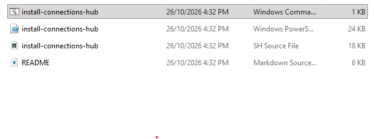
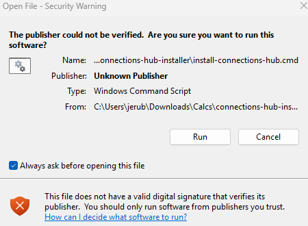
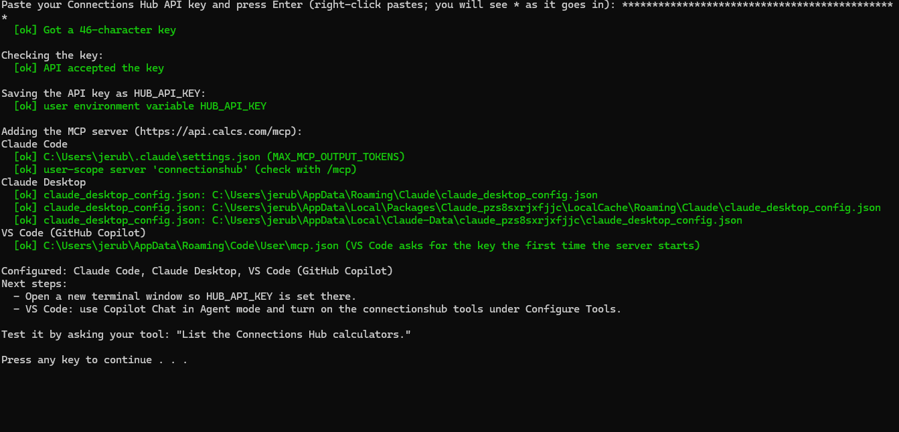

# Connections Hub installer

Sets up the HSS Connections Hub API key and MCP server for the AI tools on your machine.

**Download:** [connections-hub-installer.zip](https://github.com/owen-calcs/connections-hub-installer/releases/latest/download/connections-hub-installer.zip)

Docs: https://connectionshub.atlastube.com/docs/api/mcp

## Before you start

- **Using Claude Desktop?** Install **Node.js LTS (version 22 or newer)** from [nodejs.org](https://nodejs.org). Claude Desktop reaches the server through Node. If yours is older or missing, the installer tells you; install it and run the installer again.
- **Antivirus or a work laptop?** Add `api.calcs.com` to your antivirus's allowed or excluded websites (or ask IT). Security software that inspects HTTPS can leave Claude Desktop stuck on "Starting".

## Windows

1. Right-click the zip, choose **Extract All**, then open the folder. Don't run anything from inside the zip.
2. Double-click **install-connections-hub** with the gear icon (type: Windows Command Script). Not the other files with the same name.



3. If Windows asks **"The publisher could not be verified"**, click **Run**. If it says **"Windows protected your PC"**, click **More info**, then **Run anyway**.



4. Paste your API key from your email (right-click pastes) and press Enter. You see a `*` for each character, never the key. If Claude Desktop is open, the installer asks to close it, then reopens it when it's done.



Or from PowerShell:

```powershell
powershell -ExecutionPolicy Bypass -File .\install-connections-hub.ps1 YOUR_API_KEY
```

## Mac

On Finder:

Double click the `install-connections-hub.sh` file:


Then paste in your API key from your email. Note: paste is hidden, so it won't show you what you're pasting in for security reasons.


It will install an environment variable, `HUB_API_KEY` and install the MCP for all the installed applications it detects.


If double-clicking opens the file in a text editor instead, open **Terminal** (Cmd+Space, type Terminal, Return) and run:

```bash
bash ~/Downloads/connections-hub-installer/install-connections-hub.sh
```

Or pass the key straight in: `bash ./install-connections-hub.sh YOUR_API_KEY`

`--detect` (`-Detect` on Windows) lists the tools it finds and changes nothing. `--skip-verify` (`-SkipVerify`) skips the key check.

## What it does

1. Checks the key looks complete (starts with `zpka_`) and that the API accepts it.
2. Saves the key as `HUB_API_KEY`. On Mac that is `~/.config/connectionshub/hub-api-key.sh`, sourced from your shell rc file. On Windows it is a user environment variable.
3. Adds a `connectionshub` MCP server (`https://api.calcs.com/mcp`) to each tool it finds, and prints the full path of every file it changes:

| Tool | Config |
|---|---|
| Claude Code | `claude mcp add --scope user`, plus `MAX_MCP_OUTPUT_TOKENS` in `~/.claude/settings.json`. Only when the `claude` command is installed |
| Claude Desktop | `claude_desktop_config.json`, via `mcp-remote` (needs Node.js 22+, runs with `--use-system-ca` so security software's certificates are trusted). Windows: `%APPDATA%\Claude`, plus the Microsoft Store locations (`%LOCALAPPDATA%\Claude-Data\<package>` and `Packages\Claude_*\LocalCache\Roaming\Claude`). Closes Claude Desktop first (after asking) and reopens it |
| Cursor | `~/.cursor/mcp.json` |
| VS Code | user `mcp.json`, prompts for the key |
| Windsurf | `~/.codeium/windsurf/mcp_config.json` |
| Antigravity | `~/.gemini/config/mcp_config.json` (and `~/.gemini/antigravity/mcp_config.json` if that folder exists) |
| Codex | `~/.codex/config.toml`, reads `HUB_API_KEY` |
| Gemini CLI | `~/.gemini/settings.json`, reads `HUB_API_KEY` |

Config files are backed up as `<file>.bak-<timestamp>` before they change. A file that is not plain JSON is left alone and reported. Running the script again replaces the existing entry.

## If something goes wrong

| You see | Do |
|---|---|
| "That doesn't look like a whole key" | Copy the whole key from the email again and paste |
| "API rejected the key" | Part of the key is missing. Copy it again |
| "Could not reach api.calcs.com (…)" | Antivirus or company security is blocking it. Allow `api.calcs.com`, then run again |
| "Claude Desktop needs Node.js 22 or newer" | Install Node.js LTS from nodejs.org, then run the installer again |
| Claude Desktop shows connectionshub **Starting** forever, or **Failed** | Add `api.calcs.com` to your antivirus exceptions, then run the installer again |
| "running scripts is disabled" in red | Your company blocks scripts. Set your app up by hand: [attendee guide, section 3](https://app.notion.com/p/NCSEA-Hackathon-Connections-Hub-Starter-Kit-API-and-MCP-3f3253e39d4081668f98d0f9bd05a7f7) |

## Status

Tested 26 Oct 2026:
- **Windows 11:** full runs on two PCs, including the Microsoft Store build of Claude Desktop, an old Node.js (flagged), and antivirus that inspects HTTPS (fixed by allowing `api.calcs.com`). Claude Desktop and VS Code connected. A third PC ran the v1.0.0 release (`*` key prompt; Claude Code, Claude Desktop and VS Code configured; Claude Code connected).
- **Mac:** a full run against a fake home folder (all six detected tools configured, Claude Code connected), and an earlier version on a real Mac with Claude Desktop.
- **Antigravity** (Mac): connected and ran a calculation with the entry the installer writes.

Windsurf is now called Devin Desktop and hasn't been tested. Devin reads `~/.config/devin/mcp_config.json` and offers to copy the old Windsurf file the first time it opens.
